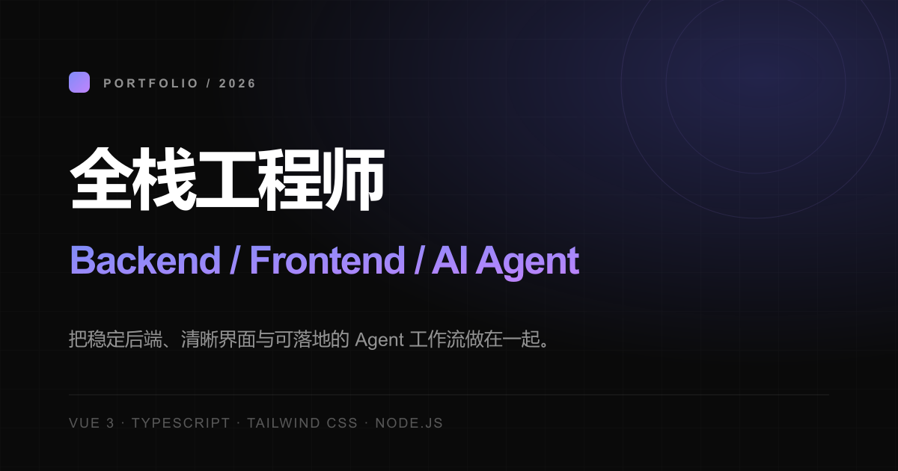
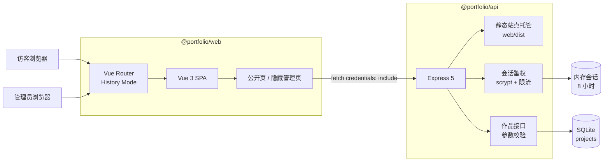

# Personal Portfolio

面试向个人作品集。公开站使用 Vue 3、TypeScript 和 Tailwind CSS，作品通过 Node.js + Express 接口读取；隐藏管理端可以新增与编辑作品，数据保存在 SQLite。



## 文档导航

- [需求文档](docs/REQUIREMENTS.md)：产品范围、信息架构、功能需求和验收标准。
- [接口文档](docs/API.md)：接口、鉴权、数据模型、错误码和调用示例。
- [OpenAPI 规范](docs/openapi.yaml)：可导入 Swagger Editor、Apifox 等工具。
- [原始 PRD](PRD.md)：项目最初的产品调研与规划记录。
- [技术设计](TECH_DESIGN.md)：最初的技术选型与目录规划。

## 已实现功能

- 响应式浅色作品集，支持桌面双栏、移动端全屏菜单。
- 精选项目优先展示，支持整卡新窗口跳转。
- 历史路由：`/projects`、`/about`、`/skills`、`/experience`、`/contact`。
- 滚动高亮、快速连续切换、浏览器前进后退和刷新直达。
- 项目数据来自 API，只展示 `published=true` 的作品。
- 独立源码、线上演示链接；空链接不会生成死链。
- 隐藏管理端，支持口令登录、作品列表、新增和编辑。
- 服务端会话、scrypt 口令比对、登录限流和管理接口鉴权。
- 示例数据、SEO、Open Graph、`robots.txt`、减少动效和键盘可访问性。

## 技术栈

| 层级     | 技术                                   |
| -------- | -------------------------------------- |
| Monorepo | pnpm workspace                         |
| 前端     | Vue 3、TypeScript、Vue Router、Vite    |
| 样式     | Tailwind CSS v4 + 自定义主题层         |
| 后端     | Node.js、Express 5、TypeScript         |
| 数据     | SQLite（Node.js 内置 `node:sqlite`） |
| 鉴权     | HttpOnly Cookie + 服务端内存会话       |
| 共享类型 | `packages/shared` workspace package  |

## 系统架构



开发环境中，Vite 运行在 `5173`，`/api` 请求代理到 Express 的 `3000` 端口。生产构建后，Express 同时提供 `apps/web/dist` 和 `/api`，也可以由 Nginx 托管静态文件并反向代理 API。

### 请求流程

1. 浏览器加载 Vue 单页应用，Vue Router 使用 History 模式解析路径。
2. 公开页请求 `GET /api/projects`，API 只返回已发布作品。
3. 管理员提交口令到 `POST /api/auth/login`，服务端校验后写入 HttpOnly Cookie。
4. 管理页携带 Cookie 调用鉴权接口，新增或更新作品。
5. Express 校验参数后写入 SQLite，并返回统一项目对象。

## 项目结构

```text
firstpro/
├── apps/
│   ├── web/                    # Vue 3 前端与隐藏管理端
│   │   ├── src/components/     # 公开页组件
│   │   ├── src/pages/admin/    # 管理端页面
│   │   ├── src/data/           # 档案、技能、经历等静态内容
│   │   ├── src/api/client.ts   # API 请求封装
│   │   └── public/             # favicon、OG 图、robots.txt
│   └── api/
│       └── src/                # Express、SQLite、鉴权与校验
├── packages/
│   └── shared/                 # 前后端共享 TypeScript 类型
├── docs/
│   ├── API.md
│   ├── REQUIREMENTS.md
│   └── openapi.yaml
├── PRD.md
├── TECH_DESIGN.md
└── README.md
```

## 本地运行

### 环境要求

- Node.js `>= 22.13`
- pnpm `11.x`

Node.js 22.13 以上版本提供项目使用的 `node:sqlite`。

### 安装

```bash
pnpm install
```

复制环境变量模板：

```powershell
Copy-Item apps/api/.env.example apps/api/.env
Copy-Item apps/web/.env.example apps/web/.env.local
```

macOS / Linux：

```bash
cp apps/api/.env.example apps/api/.env
cp apps/web/.env.example apps/web/.env.local
```

启动前后端：

```bash
pnpm dev
```

访问地址：

| 服务         | 地址                                    |
| ------------ | --------------------------------------- |
| 公开作品集   | `http://localhost:5173/`              |
| 精选项目     | `http://localhost:5173/projects`      |
| 管理登录     | `http://localhost:5173/_studio/login` |
| API 健康检查 | `http://localhost:3000/api/health`    |

如果完全没有创建 `apps/api/.env`，开发服务会使用临时口令 `change-me-now`。如果复制了示例文件但未修改，则口令是模板中的 `replace-with-a-long-random-password`。两者都只适合本地开发。

## 可用脚本

| 命令               | 作用                               |
| ------------------ | ---------------------------------- |
| `pnpm dev`       | 同时启动 Vite 和 API 开发服务      |
| `pnpm build`     | 构建前端并编译 API                 |
| `pnpm typecheck` | 检查前后端 TypeScript              |
| `pnpm start`     | 启动已编译 API，并托管前端构建产物 |

单独运行某个包：

```bash
pnpm --filter @portfolio/web dev
pnpm --filter @portfolio/api dev
pnpm --filter @portfolio/web build
pnpm --filter @portfolio/api build
```

## 页面路由

| 路径                  | 页面         | 是否公开 |
| --------------------- | ------------ | -------- |
| `/`                 | 作品集首页   | 是       |
| `/projects`         | 精选项目定位 | 是       |
| `/about`            | 关于我定位   | 是       |
| `/skills`           | 技能定位     | 是       |
| `/experience`       | 经历定位     | 是       |
| `/contact`          | 联系定位     | 是       |
| `/_studio/login`    | 管理员登录   | 隐藏     |
| `/_studio`          | 作品管理列表 | 需要会话 |
| `/_studio/new`      | 新增作品     | 需要会话 |
| `/_studio/:id/edit` | 编辑作品     | 需要会话 |

所有路径都使用 History 模式，不使用 Hash 路由。生产服务器必须将未知前端路径回退到 `index.html`。

## 环境变量

### API：`apps/api/.env`

| 变量                   | 默认值                     | 说明                                   |
| ---------------------- | -------------------------- | -------------------------------------- |
| `NODE_ENV`           | `development`            | 设为 `production` 时启用生产安全约束 |
| `ADMIN_PATH`         | `/_studio`               | 启动日志中的管理路径                   |
| `ADMIN_PASSWORD`     | 开发环境 `change-me-now` | 生产环境必填，建议使用长随机口令       |
| `SESSION_SECRET`     | 回退到管理口令             | 生产环境必填，建议至少 32 位随机字符   |
| `DATABASE_PATH`      | `./data/portfolio.db`    | 相对 API 进程工作目录                  |
| `PORT`               | `3000`                   | API 监听端口                           |
| `SEED_DEMO_PROJECTS` | 开发环境 `true`          | 空数据库是否写入示例项目               |
| `TRUST_PROXY`        | `false`                  | 是否信任一层反向代理                   |

### Web：`apps/web/.env.local`

| 变量                              | 默认值                 | 说明                             |
| --------------------------------- | ---------------------- | -------------------------------- |
| `VITE_ADMIN_PATH`               | `/_studio`           | 前端管理端路径                   |
| `VITE_API_BASE`                 | `/api`               | API 前缀                         |
| `VITE_CACHE_DIR`                | `node_modules/.vite` | 可选，自定义 Vite 缓存目录       |
| `VITE_DISABLE_DEP_OPTIMIZATION` | `false`              | 受限文件系统环境的预构建兼容开关 |

修改 `VITE_*` 变量后需要重启 Vite 或重新构建。

## 数据与示例内容

数据库默认位于 `apps/api/data/portfolio.db`，启动时自动创建表。公开列表按以下顺序排序：

1. `featured=true` 优先
2. `sortOrder` 从大到小
3. `createdAt` 从新到旧

开发环境空数据库会自动写入 4 条明确标记的示例项目。生产环境默认不自动写入示例数据。

上线前需要替换：

- `apps/web/src/data/profile.ts` 中的姓名、邮箱、社交链接和个人介绍。
- `apps/web/src/data/experience.ts` 中的示例经历与量化结果。
- `apps/web/src/data/skills.ts` 中未经真实经历支撑的技能。
- 管理端中的示例项目、截图、源码地址、演示地址和结果。
- 将真实简历放入 `apps/web/public/resume.pdf` 并配置 `resumeUrl`。

## 生产构建与部署

```bash
pnpm install --frozen-lockfile
pnpm typecheck
pnpm build
NODE_ENV=production pnpm start
```

构建完成后，`apps/api/dist/index.js` 会尝试托管 `apps/web/dist`。推荐将前后端部署在同一域名下，避免 Cookie 与跨域问题。

### Nginx 示例

```nginx
server {
    listen 80;
    server_name portfolio.example.com;

    root /var/www/firstpro/apps/web/dist;
    index index.html;

    location /api/ {
        proxy_pass http://127.0.0.1:3000/api/;
        proxy_set_header Host $host;
        proxy_set_header X-Forwarded-For $proxy_add_x_forwarded_for;
        proxy_set_header X-Forwarded-Proto $scheme;
    }

    location / {
        try_files $uri $uri/ /index.html;
    }
}
```

使用反向代理时设置 `TRUST_PROXY=true`。生产环境必须启用 HTTPS，因为生产会话 Cookie 使用 `Secure`。

## 安全说明

- 管理路径不是安全边界，真正的写操作由服务端会话保护。
- 口令通过 scrypt 派生后使用恒定时间比较。
- 会话 Cookie 为 HttpOnly、SameSite=Lax，生产环境同时启用 Secure。
- 连续 5 次错误登录后，当前 IP 在 10 分钟窗口内会被限流。
- 写接口未授权时返回 `401`。
- 管理端设置 `noindex, nofollow`，并配置 `robots.txt` 排除。
- 会话保存在进程内存中，API 重启后管理员需要重新登录。
- 不提供作品删除接口，避免误操作。

## 常见问题

### 管理接口返回 401

确认已登录、请求携带 Cookie，并使用同源地址访问前端和 API。API 重启后旧会话会失效。

### 新数据库无法写入

检查 `DATABASE_PATH` 所在目录是否可写。只读目录会导致 SQLite 返回 `attempt to write a readonly database`，接口最终返回 500。

### 刷新 `/projects` 返回 404

生产服务器没有配置 SPA History 回退。确保未知前端路径回退到 `index.html`；Express 内置托管模式已经处理此情况。

### 管理路径需要修改

同时配置 API 的 `ADMIN_PATH` 和 Web 的 `VITE_ADMIN_PATH`，再重新构建前端。隐藏路径会进入前端构建产物，不能替代密码鉴权。

## 接口摘要

| 方法 | 路径                        | 鉴权 | 说明         |
| ---- | --------------------------- | ---- | ------------ |
| GET  | `/api/health`             | 否   | 健康检查     |
| GET  | `/api/projects`           | 否   | 已发布作品   |
| POST | `/api/auth/login`         | 否   | 管理员登录   |
| POST | `/api/auth/logout`        | 否   | 清除会话     |
| GET  | `/api/auth/me`            | 否   | 查询会话状态 |
| GET  | `/api/admin/projects`     | 是   | 全部作品     |
| POST | `/api/admin/projects`     | 是   | 新增作品     |
| PUT  | `/api/admin/projects/:id` | 是   | 编辑作品     |

完整字段、响应和错误码见 [接口文档](docs/API.md)。

## 当前限制

- 管理会话只保存在单进程内存，不支持多实例共享。
- 一期不提供删除作品接口。
- 项目名称、个人资料和示例经历仍需要替换为真实内容。
- 图片管理使用 URL 字段，不提供文件上传。
- 未实现博客、中英文切换和站内 Agent 演示。
